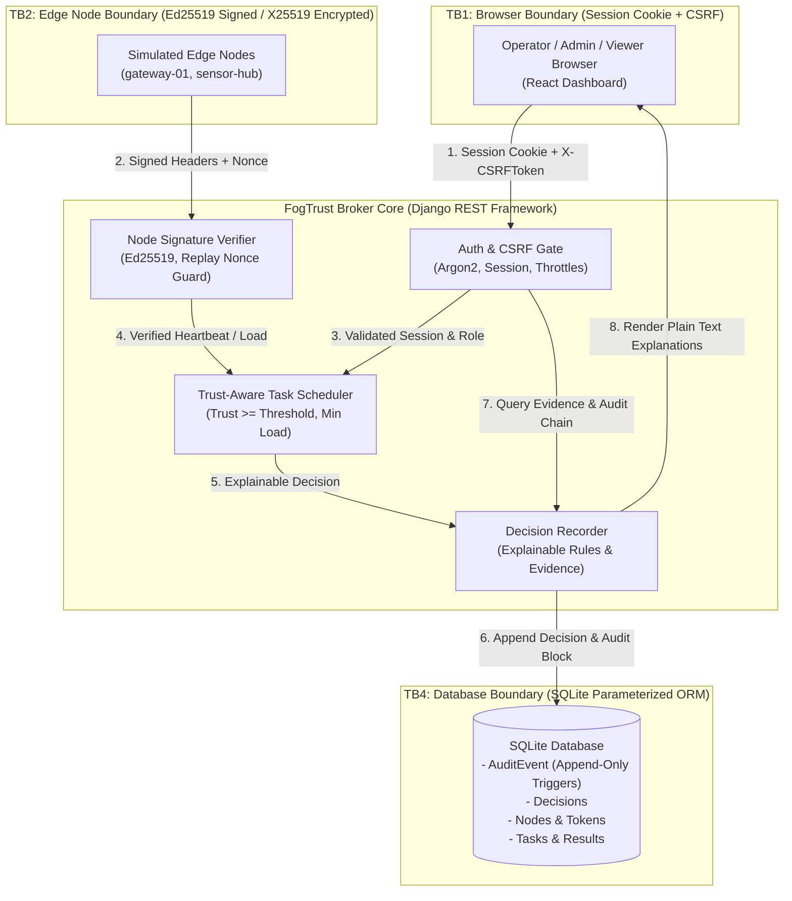

# FogTrust Member 4 Deliverable: Dashboard, Evidence View, and QA (FR-7)

| | |
|---|---|
| Author | Member 4 (Dashboard, Evidence, QA; FR-7) |
| Architecture | React (Vite) Single Page Application, TypeScript, Tailwind CSS |
| Backend Broker | Django REST Framework (DRF), SQLite |
| Scope | FR-7 Dashboard & Evidence, Trust Boundaries DFD, QA E2E Test Suite, Packaging & Scripts |

---

## 1. System Overview & Architecture

FogTrust is a secure broker for simulated fog-computing environments where edge nodes enroll with one-time tokens, prove identity via Ed25519 signatures, send periodic signed heartbeats, receive tasks based on real-time trust scoring (0–100), return encrypted results, and record immutable audit records in a SHA-256 hash chain.

Member 4 provides the centralized **Dashboard, Evidence View, and QA validation (FR-7)**:
- **Presentation Architecture:** Built with React 18, Vite, and TypeScript in `frontend/`, styled with modern dark-mode Tailwind CSS.
- **Server-Enforced Access Control:** Browser presentation strictly observes server permissions (`GET /api/v1/auth/me/`) without ever enforcing security checks solely on the client. All unauthorized requests gracefully handle server `403 PERMISSION_DENIED` errors.
- **Evidence View (FR-7 Centerpiece):** Exposes explainable decision records (`GET /api/v1/decisions/`) detailing exactly which cryptographic, replay, trust, or capacity rules passed or failed, retaining only safe non-secret evidence.
- **Audit Verification:** Provides one-click verification of the SHA-256 hash-chained audit log (`POST /api/v1/audit/verify/`), alerting administrators to any database tampering, sequence gaps, or link mismatches.
- **Sanitized Export:** Generates zero-secret operational reports (JSON/CSV) guaranteed by automated static analysis to never leak keys, tokens, ciphertexts, passwords, or IP addresses (API contract 5.10).

---

## 2. Trust Boundaries & Data Flow Diagram (DFD)

In accordance with Section 3 of `docs/threat-model/identity-access-audit.md`, Member 4 has formalized the system trust boundaries:



### Trust Boundary Analysis
- **TB1 (Browser → API):** Controls access for human roles (Administrator, Operator, Viewer). Protected by HttpOnly, SameSite=Strict cookies, rotating CSRF tokens on every state-changing call, rate limits (5/min per IP), and 30-minute idle session timeouts.
- **TB2 (Edge Node → API):** Controls edge device requests. Edge nodes use no cookies or passwords. Every request carries Ed25519 signatures, monotonic counters, and single-use nonces within a 30-second timestamp window.
- **TB3 (API → Security Engines):** Normalizes and validates incoming payloads before invoking pure-Python trust and crypto engines.
- **TB4 (API → Database):** Append-only database triggers prevent updates or deletions on `AuditEvent` records. The SHA-256 hash chain detects any out-of-band database file modifications.
- **TB5 (Admin → Configuration):** Configuration and policy updates require Administrator privileges and mandatory `change_reason` parameters, audited to the chain.

---

## 3. Dashboard Capabilities & View Guide

### 3.1 Overview (`/`)
- **System Liveness:** Real-time broker connectivity indicator querying `GET /api/v1/health/`.
- **Fleet Metrics:** Quick cards showing active vs. enrolled nodes, average fleet trust score, count of recent security denials, and audit hash chain status.
- **Demo Mode Toggle:** Built-in switch enabling offline demo simulation for university presentations.

### 3.2 Edge Nodes & Revocation (`/nodes`)
- **Node Fleet Explorer:** Displays node name, status badge, trust score progress bar, capacity/load ratio, truncated Ed25519 public key fingerprint, and last heartbeat timestamp.
- **Node Detail Inspection:** Deep dive into node parameters, key fingerprints (with copy button), and timestamps.
- **High-Impact Revocation Dialog (T5):**
  - Requires Administrator role.
  - Strict two-factor validation: administrator must type the exact `confirm_name` matching the target node and provide a reason of at least 10 characters.
  - Revocation is permanent: the server immediately begins rejecting future heartbeats with `NODE_REVOKED`, reclaims node capacity, and requeues any in-flight tasks.

### 3.3 Enrollment Tokens (`/tokens`)
- **One-Time Token Creation (FR-1):** Generates enrollment tokens with configurable expiry (default 15 minutes).
- **Single-Reveal Security:** The raw token secret is displayed **exactly once** in a high-priority modal with a "Copy" button. Once closed, the raw token is unrecoverable, as the server stores only the SHA-256 hash.
- **Token Cancellation:** Allows administrators to invalidate unused tokens before expiration.

### 3.4 Evidence View & Decisions Explorer (`/decisions` - FR-7)
- **Explainable Decisions:** Inspects why decisions were made by the broker (`allow`, `deny`, `flag`, `assign`, `revoke`, `score`).
- **Rule Checklist:** Shows every rule evaluated by the engine, its boolean pass/fail status, and explanation.
- **Non-Secret Evidence:** Inspects non-sensitive audit evidence supporting the decision (counter, last_counter, nonce_prefix, skew_s, etc.).
- **Scenario Presets:** Quick filters for demonstrated test scenarios (T2 Replayed Nonce, T4 Ciphertext Tampering, T5 Revocation Evidence).

### 3.5 Task Queue (`/tasks`)
- **Task Dispatch (FR-3):** Allows operators and admins to submit tasks with allow-listed types (`checksum`, `word_count`, `sensor_average`), priority (P1 to P5), and payload JSON.
- **Duplicate Submission Defense (T-final):** Uses automatic client-side `Idempotency-Key` generation. Repeated submissions with the same key are caught and flagged by the broker (`409 DUPLICATE_SUBMISSION`).
- **Cryptographic Result Verification (FR-5 / T4):** Displays result integrity badges confirming whether AES-256-GCM authentication tags verified successfully.

### 3.6 Audit Log & Hash Chain Verification (`/audit`)
- **Cryptographic Ledger:** Displays sequential audit records with actor attribution, action, target, outcome, and hash linkages.
- **Verify Hash Chain Action:** Recomputes SHA-256 hashes across every event from genesis. Confirms integrity or pinpoints sequence gaps, link mismatches, or edited records.
- **Tamper Simulation Button:** Allows evaluators to test breach detection directly from the UI.

### 3.7 Trust Policy (`/policy`)
- **Immutable Policy Configuration:** Displays active policy version, admission thresholds (trust score >= 70), clock skew windows, and penalty weightings.
- **Version Publishing:** Allows administrators to publish incremented policy versions with mandatory audited `change_reason`.

### 3.8 User Management (`/users`)
- **Account Administration:** List users, assign roles (Administrator, Operator, Viewer), and toggle account active status.
- **Anti-Lockout Protection (ID-14):** UI actively protects the currently signed-in administrator by disabling self-demotion and self-disabling controls, backed by server-side `409 CONFLICT` enforcement.

### 3.9 Sanitized Reports (`/reports` - API 5.10)
- **Compliance Export:** Generates sanitized operational summaries in JSON or CSV.
- **Zero-Secret Guarantee:** Strictly strips public keys, token hashes, ciphertexts, passwords, and IP addresses.

---

## 4. Security Implementation Details

1. **Server-Enforced Access Control:**
   - Role permissions are fetched via `GET /api/v1/auth/me/`.
   - Frontend UI rules (e.g. disabling buttons) exist solely for user experience. If a user bypasses client UI controls, the server responds with a generic `403 PERMISSION_DENIED` and writes an `access.denied` audit event.
2. **Zero `dangerouslySetInnerHTML`:**
   - All server-supplied strings, error messages, and explanations are rendered using safe plain-text React interpolation (`<span>{text}</span>`).
3. **Zero Secrets in Frontend Source Code or Storage:**
   - No private keys, passwords, or raw tokens are stored in `localStorage`, `sessionStorage`, or frontend source code.
4. **CSRF Protection & Session Management:**
   - All mutation requests send the `X-CSRFToken` header retrieved via cookie or handshake.
   - An inactivity timer tracks the 30-minute idle session window and alerts the user on expiration.

---

## 5. QA E2E Test Suite & Verification

The automated QA suite in `tests/e2e/dashboard.test.mjs` runs natively using Node.js without third-party test runners:

```bash
node --test tests/e2e/dashboard.test.mjs
```

### Verified Test Suites:
1. `Static Security Guardrails`: Verifies 0 occurrences of `dangerouslySetInnerHTML` and 0 private key strings.
2. `Sanitized Report Generation (API 5.10)`: Verifies zero secrets, tokens, ciphertexts, passwords, or IPs leak in JSON/CSV exports.
3. `Node Revocation Confirmation & Safety (FR-6 / T5)`: Validates exact `confirm_name` matching and minimum 10-character reason requirements.
4. `Explainable Decision Contract (FR-7)`: Validates adherence to the shared decision schema.
5. `Audit Hash Chain Verification (ID-9)`: Validates SHA-256 sequential link verification and tamper detection.
6. `Role Capability Matrix Enforcement`: Verifies permission mappings across Administrator, Operator, and Viewer.

---

## 6. Demo & Evaluation Walkthrough

Follow these steps for a complete evaluation demonstration:

1. **Launch the Demo:**
   - Run `run_demo.bat` (or `scripts/run_demo.ps1`).
   - The frontend will be available at `http://127.0.0.1:5173`.
2. **Log in as Administrator:**
   - Click "admin1" on the demo login card.
3. **Demonstrate FR-1 (Enrollment):**
   - Navigate to **Enrollment Tokens** &rarr; click **Generate Token**.
   - Note the single-reveal warning and copy the raw token.
4. **Demonstrate FR-7 (Evidence View):**
   - Navigate to **Evidence & Decisions**.
   - Use the demo scenario presets to inspect:
     - **T2 Replayed Nonce:** Observe why `HEARTBEAT_REPLAYED` was returned with `nonce_unique` failed.
     - **T4 Tampered Ciphertext:** Observe `RESULT_INTEGRITY_FAILED` due to AES-GCM tag mismatch.
5. **Demonstrate FR-6 / T5 (Revocation):**
   - Navigate to **Edge Nodes** &rarr; click **Revoke (T5)** on an active node.
   - Try typing an incorrect name to show validation.
   - Type the exact node name and enter a reason of at least 10 characters to confirm revocation.
6. **Demonstrate Audit Chain Verification (ID-9):**
   - Navigate to **Audit & Hash Chain** &rarr; click **Verify Hash Chain**.
   - Click **Simulate Tamper (ID-9)** to show detection of a modified record.
7. **Demonstrate Sanitized Reports (API 5.10):**
   - Navigate to **Sanitized Reports** &rarr; click **Export JSON Report**.
   - Inspect the downloaded file to verify all secrets and IP addresses are completely excluded.

