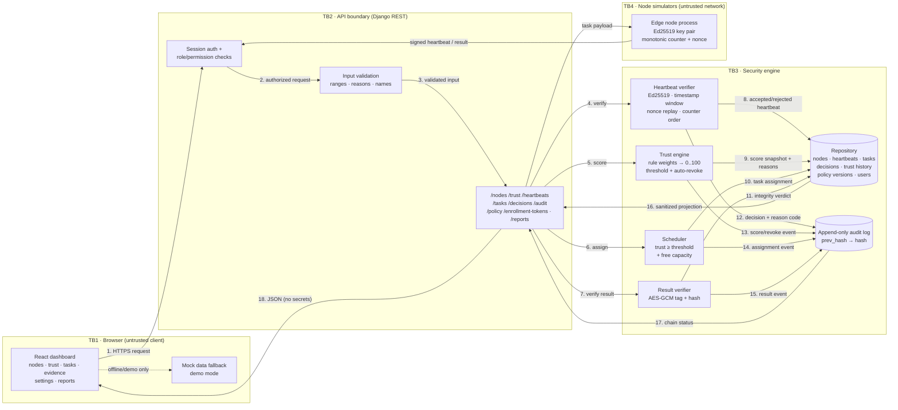
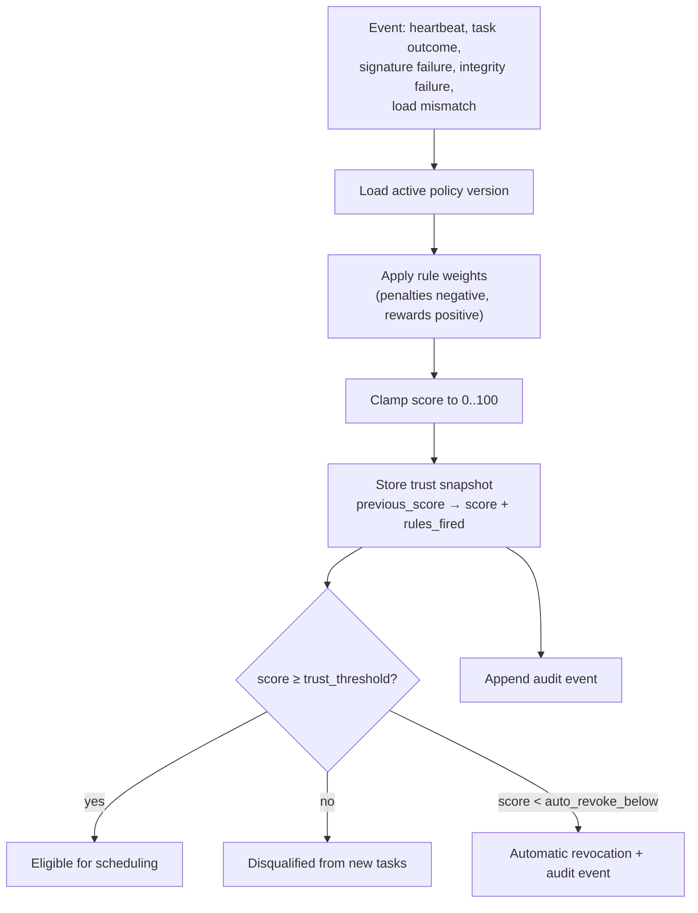

# FogTrust data flow

This document maps how data moves through FogTrust and where the trust boundaries sit. It covers the
real Phase 1 broker flows and the Phase 2 dashboard, which runs on mock data when the API is
unavailable.

## Trust boundaries

| # | Boundary | Runs where | Trusted for | Never trusted for |
|---|---|---|---|---|
| TB1 | Browser ↔ API | Operator workstation → Django broker over HTTP(S) | Rendering only; UI hiding is a convenience | Authorization, signature checks, secret storage, policy validation |
| TB2 | API ↔ Security engine | In-process Django call | Passing validated inputs and policy version | Bypassing the engine or ledger |
| TB3 | Security engine ↔ Repository | Django ORM / SQLite | Atomic reads and writes of trusted state | Treating stored blobs as already verified |
| TB4 | Broker ↔ Node simulators | Signed HTTP requests from simulated edge nodes | Node identity only after Ed25519 verification + nonce/counter + clock checks | Node-reported load, claimed results, or client clocks |
| TB5 | Repository ↔ Audit log | Append-only hash chain | Proof that no row was edited or deleted | Confidentiality (the chain is integrity, not encryption) |

The server is the only enforcement point. The dashboard hides tabs and buttons for Viewers and
Operators, but every request is re-authorized and re-validated server-side.

## End-to-end flow

## Flow notes

### 1. Enrollment

1. An Administrator creates a one-time enrollment token. The raw token is returned **once**; only its
   SHA-256 hash is stored.
2. The node simulator generates an Ed25519 key pair and submits the token plus its public key.
3. The broker checks token validity/expiry/use, registers the node with an initial trust score, and
   writes an `enrollment` decision and audit event.
4. The raw token is never written to the repository, logs, audit details, or report exports.

### 2. Signed heartbeat

Each heartbeat carries `node_id`, `counter`, `nonce`, `sent_at`, reported load, and an Ed25519
signature.

| Check (in order) | Failure code | Effect |
|---|---|---|
| Node exists | `NODE_UNKNOWN` | Reject, audit |
| Node not revoked | `NODE_REVOKED` | Reject, audit |
| Signature present | `NODE_SIGNATURE_MISSING` | Reject, audit |
| Signature verifies | `NODE_SIGNATURE_INVALID` | Reject, audit |
| Timestamp inside policy window | `HEARTBEAT_STALE` | Reject, audit |
| Nonce unseen | `HEARTBEAT_REPLAYED` | Reject, audit |
| Counter strictly greater than last | `HEARTBEAT_COUNTER_REGRESSED` | Reject, audit |

A rejected heartbeat is persisted with its exact reason code and a plain-language detail. Raw
signatures and full nonces are never returned to the browser or exported. Accepted heartbeats update
`last_seen_at`, load, and the trust score, producing a history row with rules fired, weights,
contributions, and reasons.

### 3. Trust scoring

Trust state lives in the repository; the policy document supplies the threshold and rule weights.

### 4. Task scheduling and results

1. The scheduler loads only nodes with `status = active`, trust ≥ threshold, and free capacity.
2. Assignment is transactional: task status, node load, decision, and audit event commit together.
3. A result is accepted only if it is encrypted to the broker key and its AES-GCM tag verifies.
4. Integrity failure applies the `integrity_failure` weight, records a denial decision, and can push
   the node below the auto-revocation cutoff.

### 5. Dashboard read path (Phase 2)

| View | Source | Server-side safety |
|---|---|---|
| Node status | `/api/v1/nodes/` | Fleet list never includes private keys; `enrolled` is a UI derivation from `status = active` and `last_seen_at = null` |
| Trust detail | `/api/v1/nodes/{id}/trust/` | Rule reasons are non-secret; policy version is included |
| Task history | `/api/v1/tasks/list/` | Payloads are task inputs; results expose integrity verdict only |
| Evidence | decisions, heartbeats, audit | Rejected heartbeats expose reason codes, not signatures/nonces |
| Admin settings | `GET/POST /api/v1/policy/` | Server re-validates ranges and requires an audited change reason |
| Reports | nodes + decisions + chain status | Allow-list projection + recursive secret stripping |

Every Phase 2 view has three explicit states: **loading**, **empty**, and **error**. Demo mode uses
`frontend/src/services/mockData.ts` through the same API client signatures, so switching back to the
live broker does not change component code.

### 6. Policy change

1. An Administrator edits the threshold and weights in **Admin Settings**.
2. The client validates numeric ranges, requires a reason of at least 10 characters, and shows a
   before/after diff in a confirm modal.
3. The server re-validates the same constraints, rejects non-admins, writes a new immutable policy
   version, and appends an audit event with actor, reason, and the diff summary.
4. The previous version remains readable for historical trust snapshots.

### 7. Sanitized report export

The export is allow-list based: only explicitly mapped fields are emitted, then a second defensive
pass removes sensitive keys and redacts secret-looking values.

**Never exported:** private/public keys, key fingerprints, raw signatures, nonces, token hashes or raw
tokens, ciphertext/plaintext, passwords, session cookies, authorization headers, salts, HMACs, source
IPs.

**Safe fields:** node id/name/status/trust/capacity/load/timestamps, decision id/subject/outcome/
reason code/explanation/latency/time, aggregate counts, and audit-chain verification status.

If the caller lacks `audit.verify`, the report records `audit_chain_verified = false` rather than
claiming a verification that did not happen.
