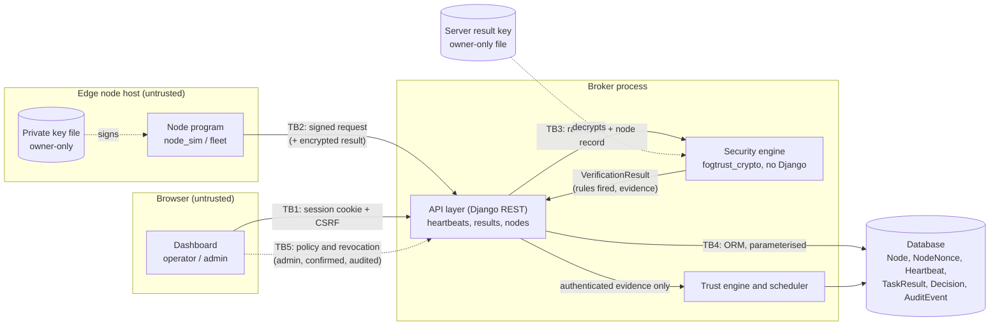
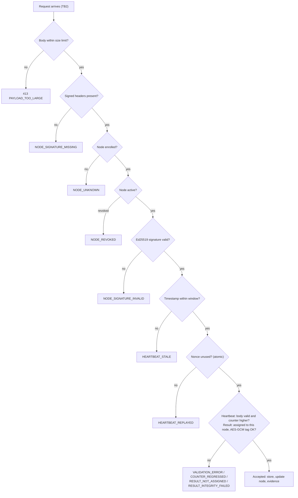

# Data-flow diagram: the crypto slice and its trust boundaries

Trust boundaries use the numbering of [identity-access-audit.md](../threat-model/identity-access-audit.md) section 3. For Member 4 to merge into the team diagram. GitHub draws the Mermaid blocks below.

## 1. Where a request crosses each boundary

## 2. What the engine checks, in order

## 3. Boundary table (for the team diagram)

| Boundary | Crossing | Controls | Threat model entries |
|---|---|---|---|
| TB1 | Browser to API (result view) | Session, CSRF, `results.view` role, `no-store`, every view audited | CR-19 |
| TB2 | Node to API (heartbeat, result) | Signature over method, path, query, time, nonce and body hash; time window; nonce; counter; size limits; rate limits | CR-1 to CR-3, CR-6 to CR-10, CR-12, CR-14 to CR-18, CR-20, CR-21 |
| TB3 | API to engine | The engine gets the raw bytes and a node record, never a framework object; it returns an explainable result | CR-8, CR-13 |
| TB4 | API to database | ORM only; unique constraints decide nonce and one-valid-result-per-task; only ciphertext stored | CR-9, CR-11, CR-18 |
| TB5 | Admin to configuration | Admin role, audit event per change | `timestamp_window_s` is set here |