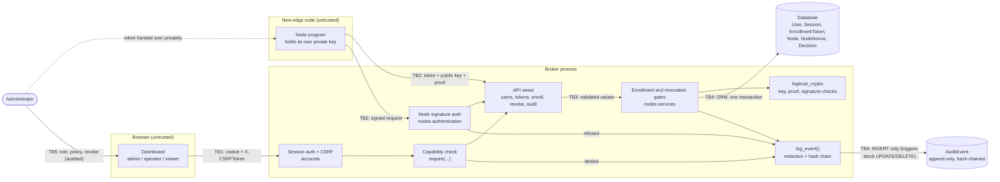
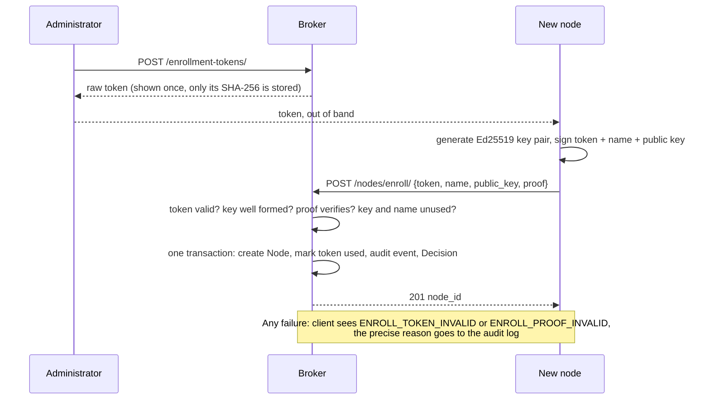

# Data-flow diagram: the identity slice and its trust boundaries

Trust boundaries (TB1 to TB5) are numbered as in [identity-access-audit.md](../threat-model/identity-access-audit.md),
section 3. For Member 4 to merge into the team diagram. GitHub draws the Mermaid blocks below.

## 1. Where requests cross each boundary

## 2. What crosses each boundary, and what is never allowed to

| Boundary | Crosses | Checked by | Never crosses |
|---|---|---|---|
| TB1 Browser → API | Session cookie (HttpOnly), CSRF header, JSON ≤ 256 KB | Session expiry, CSRF, capability table, strict serializers | Password hashes, raw tokens after creation, stack traces |
| TB2 Node → API | Enrollment: token, name, public key, proof (≤ 4 KB). Later: four signed headers | Token hash lookup, proof of possession, signature, time window, nonce, status | The node's private key (stays on the node) |
| TB3 API → engine | Already-validated values | Each rule recorded in the Decision | Raw request objects |
| TB4 API → database | Parameterised ORM queries | Unique and CHECK constraints, conditional UPDATEs, audit triggers | String-built SQL |
| TB5 Admin → configuration | Role changes, revocations, token creation | Admin capability, self-lockout guard, name confirmation | Anything without an audit event |

## 3. Enrollment, step by step

